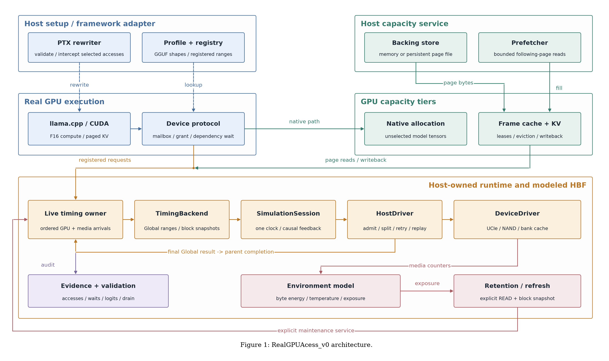

# RealGPUAcess_v0

A real CUDA execution frontend with the incremental HBF-EventLab backend.
The release provides selected weight interception, asynchronous requests,
finite frame capacity, paged F16 KV, persistent page files, bounded prefetch,
and explicitly serviced retention/refresh modeling.

The shared execution path is:

    CUDA / paged KV -> LiveTimingService -> TimingBackend
        -> SimulationSession -> HostDriver -> DeviceDriver
        -> final Global result -> parent completion -> dependent GPU work

The backend is pinned to HBF-EventLab main commit
8ccb1f353630f893f761b017d621812b7b9d5bf2. It uses the unmodified upstream source tree.
The original synchronous, immutable TensorAccessBridge remains a tested reference.
The shared asynchronous mutable path uses SimulationSession through the frontend
producer adapter. See the [adapter contract](docs/INCREMENTAL_BACKEND.md).

## Environment and build

The validated platform is Windows x64, Visual Studio 2022 C++ Build Tools,
CMake >= 3.24, Ninja, Python 3.12, CUDA Toolkit 13.0 with CUPTI/cuBLAS, and
an NVIDIA RTX 5070 (SM 120a, 12 GB). The build script defaults to the local GPU
architecture (`native`); use an explicit target for reproducible builds.
Other operating systems and GPU architectures require separate validation.

GPU architecture, toolchain paths and build directories can be selected with a
machine JSON file or build options. See [environment configuration](docs/ENVIRONMENT.md)
for migration, runtime device selection and platform support boundaries.

Run all commands from this repository root. Example paths are relative.
Set CUDA_PATH to your external toolkit installation first; toolkit binaries and
model weights are not bundled.

    python -m venv .venv
    ./.venv/Scripts/python.exe -m pip install -r requirements.txt
    ./build.ps1 -Target cuda -Python (Resolve-Path './.venv/Scripts/python.exe').Path
    $env:PATH = "$env:CUDA_PATH/bin;$env:CUDA_PATH/bin/x64;$env:CUDA_PATH/lib;$env:PATH"
    ctest --test-dir ./build-cuda --output-on-failure
    ./build.ps1 -Target model -Python (Resolve-Path './.venv/Scripts/python.exe').Path

The script locates Visual Studio and CMake/Ninja. Resolve-Path supplies an absolute
Python executable to external build tools. Use -Target cpu for the CPU-only core,
or -CudaRoot to select another toolkit. Model builds create a sealed source/build
identity and refuse to overwrite it; use a fresh source directory for a new build.

## Model inputs and execution

Provide a supported F16 GGUF and its conversion record with gguf_sha256 and
llama_commit. The framework commit must be
b3fa69955ea81c3b60e77e3c1e2224c4a826ffb9. Create ./models/ and place your
inputs there, then generate a local profile:

    ./.venv/Scripts/python.exe ./tools/integrated_profile.py --model ./models/model.gguf --conversion ./models/conversion.json --output ./configs/integrated/model.json
    ./.venv/Scripts/python.exe ./tools/run_llama_integrated.py --profile ./configs/integrated/model.json --prompt ./adapters/llama_cpp/prompt.txt --tokens 32 --output ./output/example

The runner executes native, paged bypass and modeled modes. It checks numerical
contracts, complete logits, tokens, selected access coverage, GPU waits, KV
publication, Host final outcomes, resident budgets and final close/drain.
Every run needs a fresh output directory. Profiles are derived from actual GGUF
metadata and hashes; editing a profile cannot weaken the capability checks.
Generated profiles contain resolved local model paths and are excluded from the
source archive.

For the independent operator suite, generate profiles named qwen3-0.6b.json,
qwen3-1.7b.json and smollm2-135m.json in ./configs/integrated/, then run:

    ./.venv/Scripts/python.exe ./tools/check_llama_integrated.py --profiles-dir ./configs/integrated --output ./output/operators
    ./.venv/Scripts/python.exe ./tests/integrated_validation_contract.py

The optional full matrix entry is ./tools/run_integrated_matrix.py. Its
--reference-matrix argument is a caller-supplied baseline dataset, not an installed
runtime dependency; --output must select a fresh directory.

## Supported scope and time interpretation

The accepted model scope is Qwen3-0.6B, Qwen3-1.7B and SmolLM2-135M, dense
Qwen3/llama architectures, one sequence, F16 matrix weights/KV, selected norm/down
weight accesses, and all-layer paged KV. Other tensors keep native CUDA storage.
Quantized models, MoE, multi-sequence serving and vLLM require separate work.

The baseline uses FCFS Host/NAND policies, no attached statistics observer,
and memory backing. Host resident_fragments=256 limits active logical 64-byte
fragments; it is independent of GPU frame capacity and Device MOCS. There is no
frontend Device command window. KV writeback creates a whole-block logical
snapshot; HostDriver owns command splitting, retries and physical recovery replay.
Completed Global and version history can grow with cumulative input.

Real bytes stay in GPU allocations and capacity backing. HBF-EventLab models
behavior and timing with symbolic data. The existing GPU-timestamp-driven
frontend time policy is retained; program wall time is not a hardware throughput
prediction. Measured compute records and TTFT/TPOT experiments are outside this
release. File/prefetch/environment/refresh APIs are tested separately and are not
all enabled simultaneously in model acceptance runs. Refresh requires explicit
service calls.

## Source package and documentation

- ./include/hbflab and ./src: public interfaces, producer/runtime, capacity and KV.
- ./adapters/llama_cpp/integrated: model CMake entry; adjacent files implement the
  runner, weights, KV, PTX and profiles.
- ./third_party/HBF-EventLab: complete backend source, including tests/docs.
- ./third_party/hbf-eventlab-origin.json: upstream commit, tree and file hashes.
- ./third_party/llama.cpp-integrated: pinned framework with its existing overlay.
- ./third_party/detours: Windows injection source dependency.
- ./tests and ./examples: functional, GPU, failure and injection validation.
- ./docs/validation: compact acceptance records.

See [validation](docs/VALIDATION.md), [incremental backend contract](docs/INCREMENTAL_BACKEND.md),
[dependencies](docs/DEPENDENCIES.md), [architecture](docs/ARCHITECTURE.md), and
[third-party notices](THIRD_PARTY_NOTICES.md).

Reproduce or check the source archive with:

    ./.venv/Scripts/python.exe ./tools/package_source.py create --archive ../RealGPUAcess_v0-source.zip
    ./.venv/Scripts/python.exe ./tools/package_source.py verify --archive ../RealGPUAcess_v0-source.zip

The package preserves required build-* source filenames and excludes root build
directories, model inputs, local profiles, toolchains and large runtime logs.
Its release-manifest.json records every distributed file by relative path and
SHA-256. Rebuild after extraction; prebuilt binary identities are location-bound.
