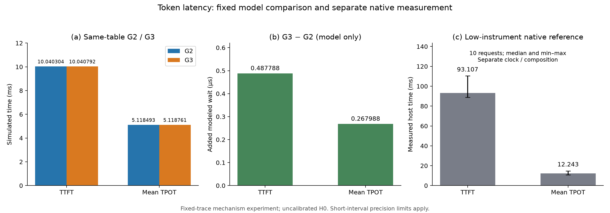

# GPU 接入 HBF 后端：S0—S9 实验报告

日期：2026-11-01

## 摘要

本系列在单请求、固定模型和小范围权重选区下，建立真实 GPU 消费者与 HBF 后端之间的同步依赖，并用同一份实测 GPU 活动固定轨迹，对比有无 HBF 等待时的模拟 token 时刻。S0—S5 在新版分类数值合同下通过；S6 仅在最小固定轨迹机制实验范围内通过；S7—S9 完成配对和交付。旧数值合同的失败、S6 原较强精度要求下的 inconclusive 均保留，不应被后续限定通过覆盖。[实验设计及阶段状态](GPU_EXPERIMENT_DESIGN.md)、[S6 限定验收](GPU_S6_MINIMUM_ACCEPTANCE.md)。

在 S8 的 M2 选区、H0 未校准参数和单条固定轨迹下，HBF 等待使模拟 TTFT 增加 0.487788 µs、平均 TPOT 增加 0.267988 µs，至第 8 个 token 的累计增量为 2.363704 µs；逐 token 差值等于此前累计等待，整数时间守恒残差为零。这验证了该配置下的门控与模拟时间记账，不能推断全模型卸载成本或真实 HBF 硬件性能。[S8 结果](GPU_S8_RESULTS.md)、[S9 结果](GPU_S9_RESULTS.md)。

## 1. 目标、方法与条件

[最初 GPU 实验交接文档](../third_party/HBF-EventLab/docs/gpu_experiment_handoff.md)要求回答：哪些权重访问经过 HBF、等待如何影响 token 完成时间、数值是否一致，以及结论依赖哪些假设。其方案以真实 GPU 计算记录、相同计算表的零等待及 HBF 对照、独立数值检查、访问及排空审计和三张图为主线。[实验设计](GPU_EXPERIMENT_DESIGN.md)将其展开为 S0—S9 阶段与进入条件；具体步骤见 [S 系列计划](GPU_S_SERIES_PLAN.md)。

主案例使用 RTX 5070、Qwen3-0.6B F16、44-token 输入、单请求单序列、greedy 解码、原生 F16 KV；关闭 CUDA graphs 和 flash attention，矩阵计算采用显式 F32，最多输出 8 个 token。算子拆分、同步及插桩是实验路径的一部分，不能视为默认服务的性能。权重真实字节保留在 GPU，HBF 使用符号内容身份；KV 不进入本次 HBF 权重空间。[S0—S2 条件](GPU_S0_S2_RESULTS.md)、[S8 条件](GPU_S8_RESULTS.md)。

TTFT 是请求起点至首个 token 可交付的时间；平均 TPOT 是首末 token 时刻差除以输出间隔数。这里不包含模型加载、分词、文本解码和传输；输出不足两枚时 TPOT 不适用。[实验设计指标定义](GPU_EXPERIMENT_DESIGN.md)、[S 系列计划](GPU_S_SERIES_PLAN.md)。

G1 提供 GPU 活动时间记录；G2 用同表进行零 HBF 等待的纯记录回放；G3 真实执行 CUDA 与同步 HBF 门控，使用相同计算表推进模拟时间。G2 不重新执行 GPU 或计算 logits；G3 的实际 GPU 和后端程序墙钟不直接加入模拟时钟。[S7](GPU_S7_RESULTS.md)、[S8](GPU_S8_RESULTS.md)。

## 2. S0—S9 逐项结果

| 阶段 | 目的与实际结果 | 可支持的结论及出处 |
|---|---|---|
| S0 | 核验模型、环境、输入容量、依赖身份和 H0 解析。 | 准备条件通过；此阶段本身没有推理或性能结论。[S0—S2](GPU_S0_S2_RESULTS.md) |
| S1 | 验证指标公式与真实桥映射。合成例 TTFT 35 µs、TPOT 12 µs；真实桥登记 16 KiB、触达 12 KiB、累计读 20 KiB。 | 合成计时、320 个 64B 片段地址、父子完成、背压及故障排空检查通过；合成值不是硬件测量。[S0—S2](GPU_S0_S2_RESULTS.md) |
| S2 | 建立无 HBF 的 GPU 事件和独立 CPU 数值基线。新版分类判据下，两组校准各 343/343 数组通过；主输入 1/2 输出分别 172/172、343/343 通过。 | 在该模型和执行条件下满足新版工程合同；旧统一阈值下两组校准曾分别有 198/343、202/343 数组超标。新版阈值不是已证明的全网络误差上界。[新版 S2](GPU_S2_B2_V2_RESULTS.md)、[旧 S2](GPU_S0_S2_RESULTS.md) |
| S3 | 单区域接入，零模拟计算；M1 4 KiB、M8 8 KiB。 | 新合同重验三方数值、依赖和排空通过；故障或限额阻止消费者继续。旧批次仅为功能诊断且当时阶段 blocked，不应改写为当时已通过。[S3—S5](GPU_S3_S5_RESULTS.md)、[旧 S3](GPU_S3_RESULTS.md) |
| S4 | 多区域 M2 与非零偏移子例，零模拟计算。 | 有效登记/触达分别为 10240 B 与 10176 B；交集、地址、数值、成功与排空通过。模拟等待分别 487788 ps、486121 ps，只是未校准 H0 功能值。[S3—S5](GPU_S3_S5_RESULTS.md)、[实验设计](GPU_EXPERIMENT_DESIGN.md) |
| S5 | 对 2/8 输出验证分段、依赖和计时；每个非空段人为设置 1000 ps，同时复验零计算。 | 本轨迹每 token 735 个有效段；固定模式 TTFT 1222788 ps、每个后续间隔 1002988 ps，时间残差为零。人工时长不代表 GPU 性能。[S5-b](GPU_S5_B_RESULTS.md) |
| S6 | HBF 关闭下采集 GPU 活动：3 对预热、10 对正式样本，冻结 sample-3 完整轨迹。 | GPU 活动并集提供固定表；按事后明确的最小机制目标限定通过。原较强短段精度要求下 inconclusive 保留，短段精度和插桩影响未解决。[S6](GPU_S6_RESULTS.md)、[限定验收](GPU_S6_MINIMUM_ACCEPTANCE.md) |
| S7 | 用固定表建立零等待 G2 对照。 | 8 输出，TTFT 10.040304 ms、平均 TPOT 5.118493 ms；三次回放确定一致，HBF 访问和等待为零。它是回放，不是新 GPU 测量。[S7](GPU_S7_RESULTS.md) |
| S8 | 同表执行真实 GPU 与 HBF 同步门控 G3，完整核验一次、timing 两次。 | 所有选区依赖成功，三次模拟状态一致；逐 token 配对时间守恒为零。数值及访问审计通过。[S8](GPU_S8_RESULTS.md) |
| S9 | 整理 S6—S8 的三图、数据、覆盖、数值、结束状态和溯源。 | 固定轨迹最小交付完成；软件成本若未独立测量则明确留空。S10 敏感性扩展未执行。[S9](GPU_S9_RESULTS.md) |

## 3. 配对结果及解释

| 指标 | G2 零等待 | G3 HBF 门控 | 差值 |
|---|---:|---:|---:|
| 模拟 TTFT | 10.040304 ms | 10.040791788 ms | 0.487788 µs（约 0.00486%） |
| 模拟平均 TPOT | 5.118493 ms | 5.118760988 ms | 0.267988 µs（约 0.00524%） |
| 请求至最后 token | 45.869755 ms | 45.872118704 ms | 2.363704 µs |

首输出前累计 HBF 等待 487788 ps；后续 7 个区间各等待 267988 ps。因此总等待为 487788 + 7 × 267988 = 2363704 ps。固定表相同且此实验使用同步门控，逐 token 的 G3−G2 差值等于此前累计等待；每个区间的差值等于该区间等待。以上百分比按表中 G2 为分母计算。[S8 配对与审计](GPU_S8_RESULTS.md)、[逐 token 数据](validation/gpu-s9/paired-tokens.csv)。

图中 native 主机计时与模拟指标口径不同，不能用其比值推断硬件 slowdown。[S9 图表说明](GPU_S9_RESULTS.md)。

## 4. 在限定条件下可以得出的结论

1. **后端依赖链在所测访问上正确闭合。** S8 中 16 次父读、24 个读 Global、1280 个 64B 逻辑片段全部成功；父完成等于最后子 Global 完成，消费者提交发生在依赖成功之后，最终正常排空。故障及限额的阻止继续执行证据来自 S3/S5，不应与 S8 正常延迟混合。[S8](GPU_S8_RESULTS.md)、[S5-b](GPU_S5_B_RESULTS.md)。
2. **同一路径的数值在本案例中保持一致。** S8 native 和 G3-full 各 1369 个 CPU 比较数组通过新版 B2；两条 GPU 路径有效快照及完整 logits 逐位一致。该结论限定于所测模型、输入、精度与执行方式；新版 B2 为分类工程预算，不是任意模型的理论误差界。[S8](GPU_S8_RESULTS.md)、[新版 S2](GPU_S2_B2_V2_RESULTS.md)。
3. **模拟等待被正确反映到 token 时刻。** 对所用固定轨迹及 H0 参数，逐 token 和逐区间配对残差均为零；G3 实际提交后端访问，G2 不提交。这个因果关系是所测同步模型的结论，HBF 状态和等待也可能依赖计算轨迹。[S8](GPU_S8_RESULTS.md)、[S6 限定验收](GPU_S6_MINIMUM_ACCEPTANCE.md)。
4. **本次结果的覆盖范围很小。** M2 有效登记与唯一触达均为 10240 B，累计有效读 81920 B；有效选区仅占模型权重约 0.000681%。因此微小增量不能推广到所有权重或全模型卸载。[S9 覆盖](GPU_S9_RESULTS.md)、[覆盖数据](validation/gpu-s9/coverage.csv)。

## 5. 局限与后续工作

H0 尚未校准，权重仍在 GPU，当前访问是符号后端模型而非真实 NAND 字节搬运；因此模拟差值不能当作硬件实测延迟或预测。S6 单短段精度、分辨率与逐窗口同步/采集扰动仍有不确定性；固定表的高精度数字只是模型记账精度。实际案例达到 8 输出上限，没有观察到自然 EOS；七个输出间隔不足以估计可靠 p99。[S6 限定验收](GPU_S6_MINIMUM_ACCEPTANCE.md)、[S8](GPU_S8_RESULTS.md)、[S9](GPU_S9_RESULTS.md)。

后续可校准 HBF 参数，扩大权重覆盖并进行配置和多轨迹敏感性实验；针对目标效应制定短段精度和扰动验证方案；独立测量初始化、后端 CPU 等待及关闭排空等软件成本。上述工作属于后续验证，不能视为本轮已经完成。[S6 限定验收](GPU_S6_MINIMUM_ACCEPTANCE.md)、[S9 缺项](GPU_S9_RESULTS.md)。

## 6. 证据与复现入口

设计和原始要求见[交接文档](../third_party/HBF-EventLab/docs/gpu_experiment_handoff.md)、[实验设计](GPU_EXPERIMENT_DESIGN.md)和[分步计划](GPU_S_SERIES_PLAN.md)。阶段报告及结构化摘要均在上文逐项链接；S9 汇总三图、CSV、来源与审计索引，原始 GPU/快照数据位于对应本地 `output/gpu-s/` 批次。S7/S8 共享计算表 SHA256 为 `ff8c7d97d9527d2caf99d4a154068be416c88b60506d4d7a82e86f580f5f5394`。[S9 来源及复现](GPU_S9_RESULTS.md)。本报告为已有记录的整理，没有重新执行实验。
