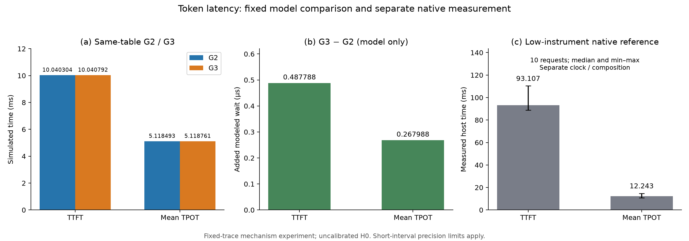
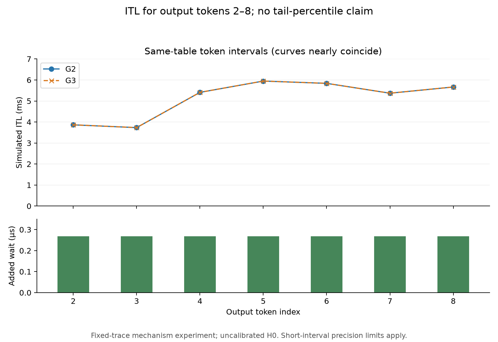
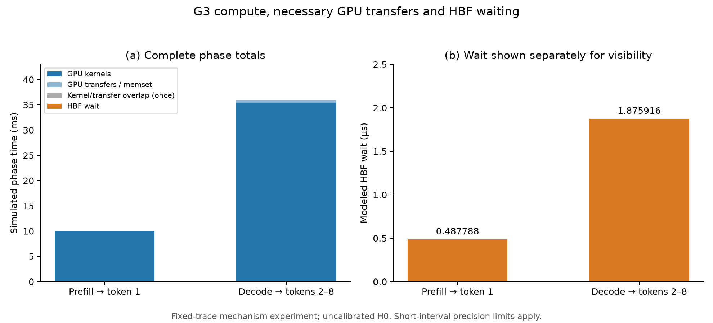

# S9：固定轨迹最小实验的图表与结果交付

批次`output/gpu-s/20261101-s9-002/`。**S9通过，S系列原始最小交付在限定范围内完成；S10可选扩展未执行。** 本次只分析已通过的S7/S8及其绑定的S6数据，没有新增GPU采样、修改固定表或运行A系列回归。

验收范围为`minimum_fixed_trace_mechanism_experiment`：同一完整实测固定轨迹下，验证选区等待如何改变模拟token时刻。S6的短段波动、分辨率和观测扰动限制仍然适用，不据此宣称真实硬件可观测微小收益、NAND字节搬运、权重显存卸载或校准后硬件预测。范围依据见[S6限定验收](GPU_S6_MINIMUM_ACCEPTANCE.md)，真实执行证据见[S8结果](GPU_S8_RESULTS.md)。

## 1. 主要结果

| 指标 | G2：零等待固定表 | G3：同表＋真实提交的HBF依赖 | 增量 |
|---|---:|---:|---:|
| 模拟TTFT | 10.040304ms | 10.040791788ms | 0.487788µs |
| 模拟平均TPOT | 5.118493ms | 5.118760988ms | 0.267988µs |
| 最后token相对t0 | 45.869755ms | 45.872118704ms | 2.363704µs |

8个token的累计差值均等于此前累计实际HBF等待，逐区间整数ps残差全部为0。首输出区间等待487788ps，后续7个区间各267988ps。G2三次回放确定性通过；G3一次full、两次timing的模拟时刻和后端状态相同，主机观测时间戳不要求跨进程相同。数据见[逐token配对CSV](validation/gpu-s9/paired-tokens.csv)。

该结果验证固定轨迹下的等待因果和时间记账。当前仅接入模型很小的权重范围，且H0参数未校准；本次小增量不能解释为整个模型的HBF访问开销很小，也不能以GPU计时噪声大小改变模拟时间守恒的含义。

## 2. 三张主图

### 图1：TTFT与平均TPOT



左面板G2/G3共用固定表，模拟轴从0开始。中面板单列微秒级等待，避免在完整坐标下不可见；数值有效位数表示整数模型记账，不代表实测硬件精度。右面板是S6的10次低插桩native请求，用单调CPU时钟统计各次TTFT/TPOT后分别取中位数，误差线为样本最小至最大，不是置信区间。各指标独立取中位数，不要求其统计值相加等于请求总时长中位数。

三个面板组成不同，不以native/G2/G3比值声称硬件slowdown。右图保留节点调度、同步与必要记录，非最优无插桩服务性能。绘图数据：[模型指标](validation/gpu-s9/figure1-metrics.csv)、[原生参考](validation/gpu-s9/native-reference.csv)；[SVG](figures/gpu-s9/figure1-ttft-tpot.svg)。

### 图2：逐token ITL



上面板给出完整模拟ITL，曲线近乎重合；下面板单列各区间增加的0.267988µs等待，没有通过截断完整ITL坐标夸大差异。只有7个输出间隔，不估计可靠p99。数据：[ITL CSV](validation/gpu-s9/figure2-itl.csv)；[SVG](figures/gpu-s9/figure2-token-itl.svg)。

### 图3：prefill/decode分解



| 阶段 | GPU kernel-only | 必要GPU传输/memset | HBF等待 |
|---|---:|---:|---:|
| Prefill至首token | 9.964845ms | 0.075459ms | 0.487788µs |
| Decode至token2—8合计 | 35.433564ms | 0.395887ms | 1.875916µs |

GPU活动采用区间并集，分解为互斥kernel-only、transfer-only与两类重叠；本轨迹重叠部分为0。主图保留完整阶段总长，HBF等待另面板显示。首token由prefill logits选出，故prefill阶段含当前token之前的必要回传尾段；不是另加一次decode或整次请求tail。

数据：[阶段CSV](validation/gpu-s9/figure3-phases.csv)、[逐步分解CSV](validation/gpu-s9/step-decomposition.csv)；[SVG](figures/gpu-s9/figure3-prefill-decode.svg)。

## 3. 覆盖、精度与结束状态

M2有效登记10240B，注册12288B含2048B填充；触达区间并集10240B，累计有效读81920B。8步共16次父读、24个读Global、1280个64B片段及读尝试，完整初始化、内容和地址审计通过。模型权重总字节1503395840B，登记有效范围占约0.000681%；此小范围不能外推为全权重卸载。[覆盖CSV](validation/gpu-s9/coverage.csv)包含三类覆盖、填充及比例，未将填充当作有效权重。

最终native和G3-full各1369个CPU比较数组全部通过分类B2判据；两条GPU路径3608个有效快照数组与完整logits逐位一致。数值表同时导出测得最大相对RMS、最大归一化元素误差及各自阈值，避免将阈值误认为测量值：

- [逐step/类别误差与阈值](validation/gpu-s9/numerical-by-step.csv)。
- [逐数组原始误差摘要](validation/gpu-s9/numerical-arrays.csv)。完整logits作为跨全部输出的单个比较项明确标为`all_outputs`，不伪装为逐token独立误差检查。
- [实际结束状态](validation/gpu-s9/status.csv)：8输出、处理51个位置、上限结束，未观察到自然EOS；CUPTI dropped=0，所有G3正常关闭、Host/Device排空、无依赖失败。
- [历史阶段状态](validation/gpu-s9/stage-history.csv)：保留旧S2阻断、旧S6精度范围inconclusive及后续最小范围限定pass、S8先行审计中止和最终通过，不把旧失败混入成功时延。

S7未重新计算logits；S8的真实GPU/后端执行没有被纯记录回放替代。N=0/1、EOS等边界工具测试来源于前序S1，不冒充本例自然GPU EOS或新增测试。

## 4. 程序成本及缺项

| S8运行 | 整个进程墙钟 |
|---|---:|
| native完整核验 | 22.921452s |
| G3完整核验 | 23.085052s |
| G3 timing-1 | 18.259698s |
| G3 timing-2 | 18.369312s |

这些成本包括加载、初始化、执行、同步、CUPTI/文件记录及退出，不是GPU工作量或模拟HBF时延。S6低插桩native请求至最后token中位数180.75025ms，与带逐窗口采集请求的16597.165ms也不能直接当作硬件性能比。S8 timing仍保留因果审计所需活动记录，只关闭数值快照。

模型加载、后端初始化、后端CPU等待、关闭排空**未独立记录墙钟**；[软件成本CSV](validation/gpu-s9/software-costs.csv)明确留空并标`not_separately_recorded`，不从总成本或模拟Tick倒推。初始化的3172402ps仅为独立于请求t0的模拟初始化时间，不是CPU初始化成本。该成本分项缺项随交付保留；本轮没有为凑表新增测量，也未运行不受本次分析改动影响的A系列回归。

## 5. 来源、复现与审计

本轮统一使用S7/S8的同一计算表，SHA256为`ff8c7d97d9527d2caf99d4a154068be416c88b60506d4d7a82e86f580f5f5394`。来源包括：

| 交付 | 可核验依据 |
|---|---|
| 三张主图与CSV | S8的paired/decomposition记录；图1另绑定S6逐次native主机记录 |
| 数值/覆盖/状态 | S8 stage、完整numerical与session/summary、前序限定验收记录 |
| GPU/工具链/模型/配置 | `effective-settings.json`、源S0 environment/profile、S8 conditions和依赖seal身份、完整有效H0 |
| 表与模型/输入/事件/二进制身份 | 复制的完整表header及S8 conditions；模型文件不随图表包分发 |
| 每个输入的来源与SHA256 | `provenance.json`及`inputs/`快照树 |
| 每张图的绘图CSV | `figure-sources.json` |
| 原始token/门控独立核验 | `figure-audit.json`，逐token整数配对残差0，PNG/SVG格式和渲染排版通过检查 |
| 交付文件完整性 | `artifact-index.json`及交付ZIP校验 |

完整结果目录为`output/gpu-s/20261101-s9-002/`，附`report.md`、绘图脚本、公共辅助模块、版本记录、全部表、6个图文件及输入快照。本仓库同时保存三图与CSV副本，见本报告链接；更大的原始GPU/快照仍位于S6/S8对应批次。

从工作区重新分析（新目录）并核验：

```powershell
python experiments/gpu_s/s9.py --study output/gpu-s/<new-S9-id>
python experiments/gpu_s/s9_validate.py --study output/gpu-s/<new-S9-id>
```

已有交付目录或解压包可仅用已复制CSV独立重建图，无需GPU/后端/模型：

```powershell
python <artifact-folder>/s9.py --study <artifact-folder> --plot-only
```

绘图环境记录于`plot-environment.json`（本次Matplotlib 3.11.1、NumPy 2.4.6、Agg、DejaVu Sans）；不保证跨版本SVG字节一致，但数据/坐标/单位必须一致。

原文第8节的三图、覆盖/配置/数值/结束状态和第9节的来源与复现要求在上述交付中对应记录。首轮最小实验已在固定轨迹范围内完成；S10敏感性、单短段更强精度验证、真实HBF校准和成本分项补测仍是后续工作，不作为本轮已经取得的结论。
