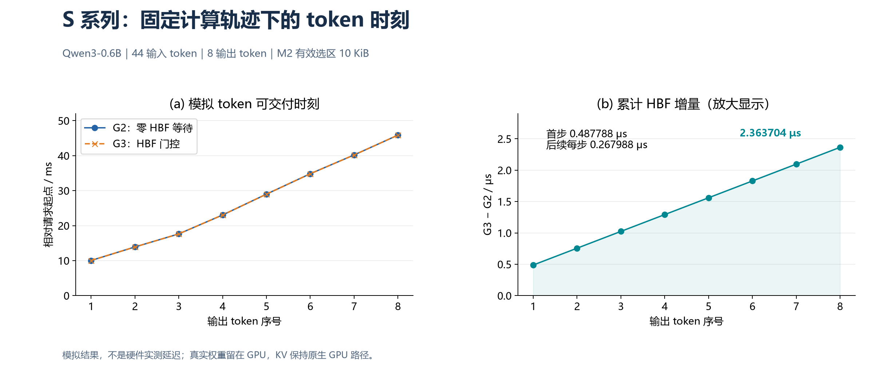
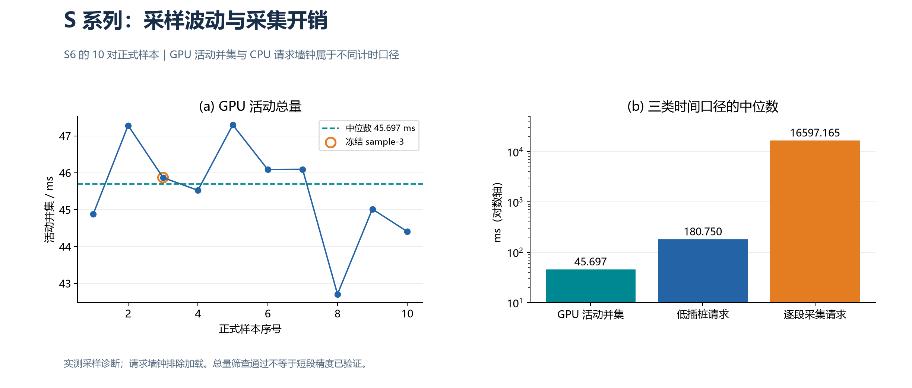
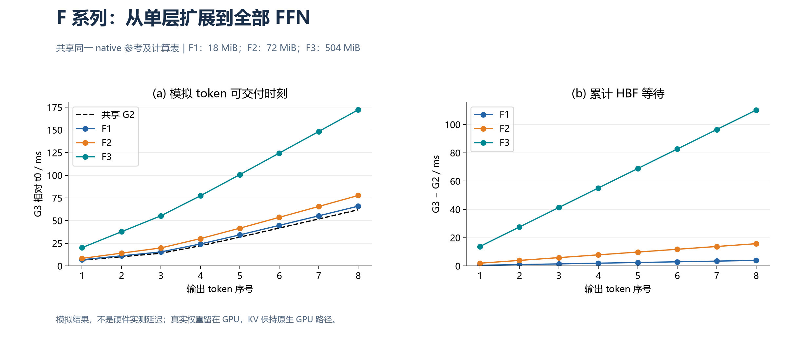
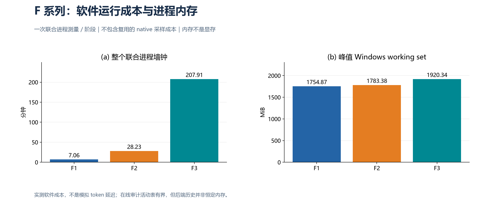
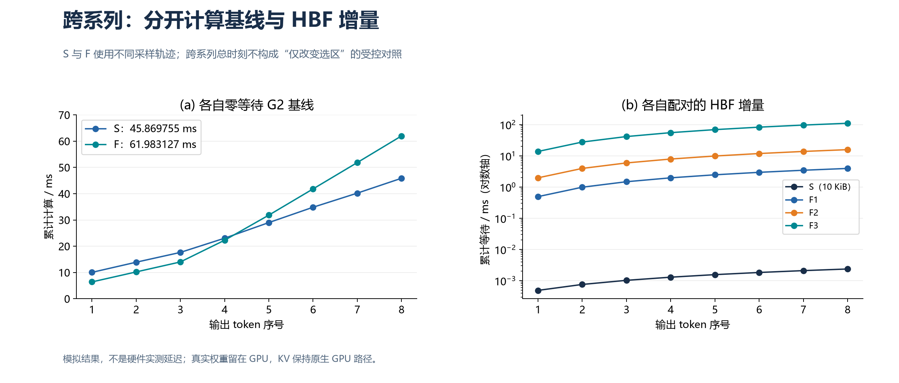
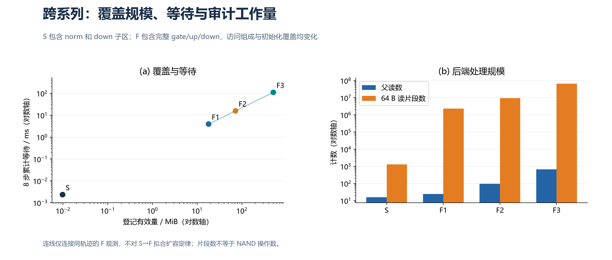
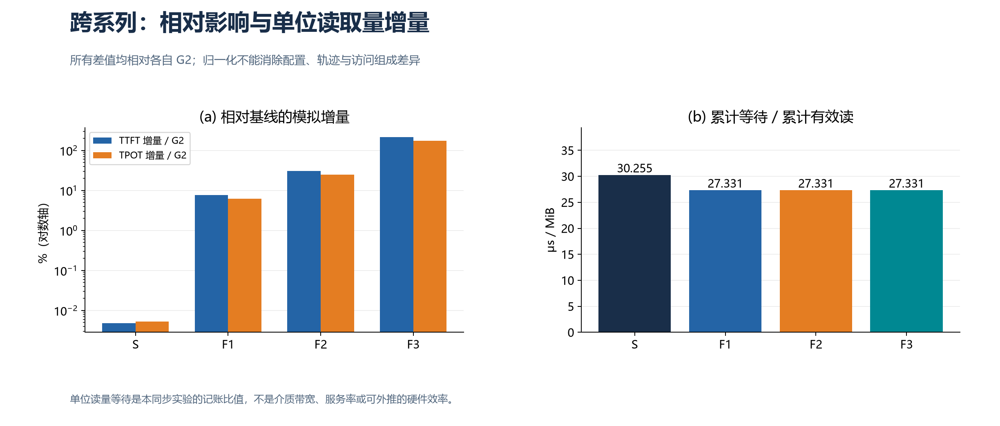

# S 与 F 系列 GPU/HBF 联合实验报告

日期：2026-11-05。本文整理已有记录，没有重新执行推理。模拟时钟、实测 GPU 活动、软件墙钟分别报告。

## 摘要

S 系列建立小选区的数值、依赖和计时证据；F 系列把覆盖扩大到全 28 层 FFN 的 gate/up/down。S 的 8 步累计 HBF 等待为 **2.363704 μs**，F1/F2/F3 分别为 **3.935599248、15.742396992、110.196778944 ms**。两系列各自配对的时间残差均为零，但计算轨迹不同，不能把跨系列总延迟差异全部归因于扩容。

## 1. 两系列实验的基本设置

| 条件 | S 系列主结果（S8/S9） | F 系列（F1/F2/F3） |
|---|---|---|
| 模型与输入 | Qwen3-0.6B F16 GGUF；44-token 输入；greedy；8 输出 | 同一模型和输入；8 输出 |
| GPU 与精度 | 原始主案例 RTX 5070；原生 F16 KV；MUL_MAT 显式 F32 | RTX 5070；相同类型的精度与同步路径 |
| 执行控制 | 单请求、单序列；关闭 CUDA graphs 与 flash attention | 同左；context/batch/ubatch = 512/256/256 |
| HBF 选区 | 第 10 层 norm 4096 B + down 的 6144 B 子区 | 第 10 层 / 第 0、10、20、27 层 / 全 28 层的完整 gate/up/down |
| 有效登记量 | 10 KiB；注册 12 KiB，含 2 KiB 填充 | 18/72/504 MiB；无尾填充 |
| H0 逻辑容量 | 8 MiB | 统一 512 MiB |
| 容量几何 | 1 通道 × 1 die × 2 bank × 64 block × 16 page × 4096 B | block/bank 改为 4096，其他并行结构保留 |
| 固定计算表 | S6 sample-3；18072 窗口；45.869755 ms | 单次 native 新采集；18072 窗口；61.983127 ms |
| 数值与审计 | CPU 分类合同、GPU 快照/logits、片段明细、因果检查 | native 完整 logits/token 对照；在线片段审计和父级记录 |
| 采样与重复 | S6 10 对正式样本；S8 full 一次、timing 两次 | native 一次，F1/F2/F3 各一次 |

8 MiB 是旧实验的几何容量选择，不是接口大小或后端容量上限。F 明确设置 512 MiB 后，504 MiB FFN 留有 8 MiB 余量。F 活动片段预算仍为 256，累计逻辑片段保护为 10 亿，累计事件数不设上限；这些预算不等于吞吐能力。

两系列真实权重均留在 GPU，HBF 保存符号内容身份并模拟时序，KV 未接入 HBF。初始化普通写在请求 t0 前完成，不计入 token 模拟延迟或累计有效读。G3 真实执行 CUDA，选区消费者等待 HBF 成功后提交；G2 是同表零等待记账，不是另一轮 GPU 性能测量。TTFT 是首 token 相对 t0 时刻，平均 TPOT 为首末 token 时刻差除以 7。

图片样例仅参考版式；其“RTX 4070 Laptop 执行”注记不移植到本文。本文分析的是保存的原 S8/S9 RTX 5070 主案例。

## 2. S 系列可视化分析

S0—S2 准备环境、映射和数值基线；S3—S5 验证选区、依赖门控、故障阻断与人工计时；S6 采集轨迹；S7 建立零等待 G2；S8 执行联合 G3；S9 汇总。旧统一数值阈值曾失败，后按分类工程合同验收，不能将新合同描述为全网络理论误差界。S6 原较强短段精度要求下的 inconclusive 仍保留，后仅在最小固定轨迹机制目标下限定通过。

**图1解释。** 左图两条曲线几乎重合，因为 ms 级计算基线上只叠加 μs 级等待。右图单独放大差值，避免误读为“没有影响”：首步等待 0.487788 μs，之后每步 0.267988 μs，第 8 个 token 累计 2.363704 μs。首步与后续增量不同是本次状态下的观察，不应强行拟合为过原点直线。各 token 满足 G3−G2=此前累计等待。

**图2解释。** 10 次 GPU 活动总量范围为 42.707339–47.299544 ms，中位数 45.696915 ms，sample-3 按预定规则成为固定表。右图三类时间的中位数约为 45.697、180.750、16597.165 ms，展示了活动并集与带采集请求墙钟的明显口径差异。对数轴用于容纳数量级差距，不能将比值当作硬件 slowdown。总量筛查通过并没有解决短段稳定性：输入 gap/输出 tail 的极差/中位数约 34%–105%；整数 ns 存储也不证明 ns 级测量准确度。

S8 的 16 次父读、24 个读 Global、1280 个 64 B 读片段均成功。native/G3 的有效快照及完整 logits 逐位一致，各 GPU 路径的 1369 个 CPU 比较数组通过分类合同，最终正常排空。三次 G3 模拟状态一致证明固定条件下的可重复性，不构成硬件延迟分布。

## 3. F 系列可视化分析

**图3解释。** 三个阶段共用相同 G2，计算基线已固定。覆盖从 18 MiB 扩至 72 MiB、504 MiB 后，G3 与 G2 的间距逐级增加。每步等待分别为 0.491949906、1.967799624、13.774597368 ms，8 步累计等待呈 1:4:28。这是本组参数、同步访问和轨迹的观察结果，不是任意配置的线性定律。

| 指标 | F1 | F2 | F3 |
|---|---:|---:|---:|
| 完整矩阵 | 3 | 12 | 84 |
| 父读数 | 24 | 96 | 672 |
| 累计有效读 / MiB | 144 | 576 | 4032 |
| 模拟 TTFT / ms | 6.892433 | 8.368283 | 20.175080 |
| 模拟平均 TPOT / ms | 8.432328 | 9.908177 | 21.714975 |
| 最后 token 时刻 / ms | 65.918726 | 77.725524 | 172.179906 |

**图4解释。** 联合进程耗时约 7.06、28.23、207.91 分钟，峰值 working set 约 1754.87、1783.38、1920.34 MiB。F3 的约 3 小时 28 分钟是仿真软件、GPU 执行与记录的实际运行成本，不能与 110.197 ms 模拟等待混用。在线审计在完成后释放片段/attempt 明细，活动峰值保持 256；总进程仍含模型、运行时及后端完成历史，不能宣称恒定内存。单次成本不支持稳定吞吐、置信区间或 p99。

F3 完成 1,032,192 个读 Global、66,060,288 个读片段和 8,257,536 个初始化写片段，处理 5,077,771,439 个后端事件。各级完整 logits/token 与 native 逐位一致，时间残差为零，无逻辑失败或 attempt 错误并正常排空。F 未重复 S 的全套 CPU 中间数组验证；它验证的是扩容后的完整矩阵覆盖和同 GPU 路径数值保持。

## 4. 两系列对比可视化分析

**图5解释。** S 的 G2 首 token 为 10.040304 ms，F 为 6.400483 ms；最后 token 的 G2 则分别为 45.869755 和 61.983127 ms。基线不只是总量不同，时间分布也不同，因此 S-G3 与 F-G3 的绝对差不能解释为单纯扩容代价。右图展示各自内部配对的等待，用对数轴保留 S 的微小效应。同一模型、输入和输出序列不保证两次实测计算轨迹相同。

**图6解释。** S 的 10 KiB 到 F3 的 504 MiB，登记量扩大 51609.6 倍，累计读由 80 KiB 增至 4032 MiB，等待从 2.363704 μs 增至 110.196778944 ms。只连接同轨迹的 F 点，S 独立展示。右图表明父访问数不能单独代表处理工作量：读片段从 1280 增至约 6606 万。S 含 norm 与 down 子区，F 为完整 FFN 三矩阵，二者并非严格包含的选区；容量、组成及初始化状态均有变化，不能仅按字节比推导跨系列时延。

**图7解释。** S 的 TTFT/TPOT 相对增量约 0.00486%/0.00524%，F3 约 215.21%/173.48%。分母是各自 G2，且图中采用对数轴，不能将其读作同一基线的硬件减速。单位有效读的累计等待，S 约 30.255 μs/MiB，F 各级约 27.331 μs/MiB。这个比值只描述本同步记录，不能反推介质带宽或宣称 F 的硬件效率更高。S 没有与 F 对齐的加载/后端/关闭软件分项，本报告不补估，也不将缺失值画成零。

## 5. 结论

1. **S 验证小选区机制闭环，F 验证所测请求下全 FFN 可运行。** S 提供数值、映射、依赖及计时证据；F3 将完整 gate/up/down 覆盖扩至 28 层、84 个矩阵、504 MiB，并完成实际联合执行和审计。
2. **选区访问的等待被正确加入 token 模拟时钟，数值保持一致。** 各系列内部配对残差均为零；F 共用轨迹下等待呈 1:4:28。结论限于所测同步方式、参数和请求。
3. **容量与软件成本是两类问题。** 512 MiB 配置可容纳全 FFN，但仿真仍需数小时。在线记录减轻了明细保留成本，没有消除数千万片段、数十亿事件的处理成本。
4. **这不是全部模型或真实卸载的适配证明。** attention、embedding、输出层和 KV 不在 F 权重接入范围。只测一个输入、8 输出，无自然 EOS 或多请求统计；HBF 未校准，计算轨迹存在采集扰动与短段不确定性。若要隔离扩容效应，需要同一计算轨迹下重做 S/F 配对，并控制访问组成、初始化及其他配置。

## 6. 来源与复现

- [S0—S9 原报告](../../../docs/GPU_S0_S9_EXPERIMENT_REPORT.md)、[S6 限定验收](../../../docs/GPU_S6_MINIMUM_ACCEPTANCE.md)、[S8 结果](../../../docs/GPU_S8_RESULTS.md)、[S9 汇总](../../../docs/GPU_S9_RESULTS.md)。
- [F1](GPU_F1_RESULTS.md)、[F2](GPU_F2_RESULTS.md)、[F3 及三阶段对照](GPU_F3_RESULTS.md)。
- [绘图数据与来源哈希](validation/gpu-s-f/plot-data.json)；7 张图均有 PNG/SVG，保存在 `figures/gpu-s-f/`。

S 表 SHA256：`ff8c7d97d9527d2caf99d4a154068be416c88b60506d4d7a82e86f580f5f5394`。
F 表 SHA256：`cdb402ec39ea930f7b81d08e12b64bddeeff2a38df314e42c9d26bf7ed4a4799`。
